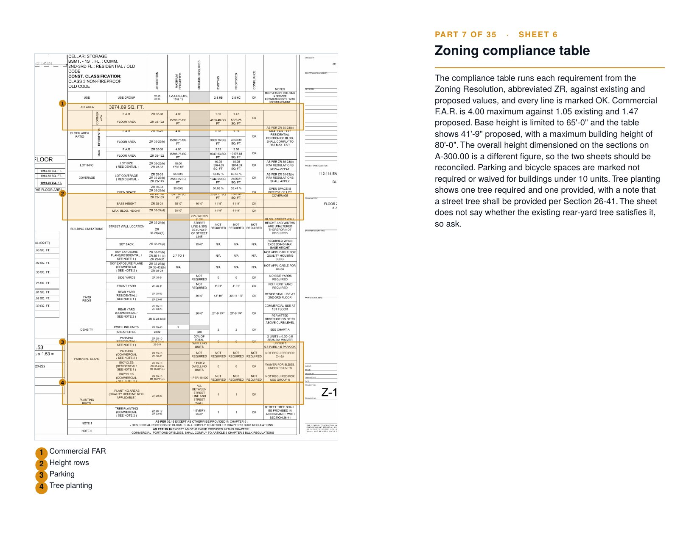
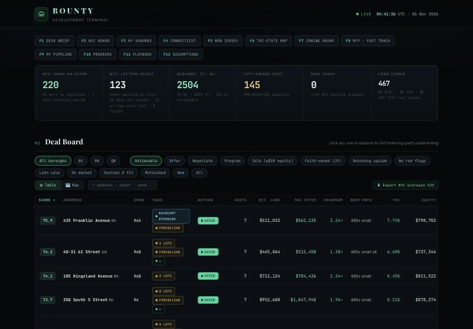
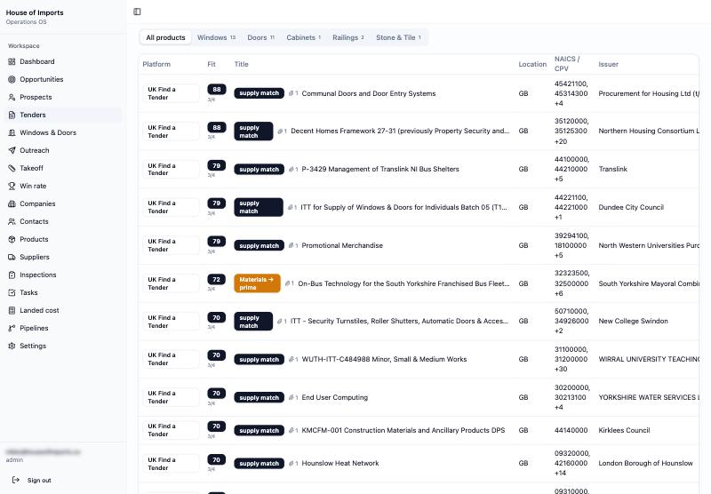

### Nikko Shkreli
Construction project manager and founder building AI tools for construction and real estate.

#### PlanBrief
Upload an RFP or plan set and get a narrated walkthrough video, a highlighted Plan Reader's Guide, material takeoffs and per-trade bid packages. Figures are verified against the sheets. (Code: [planbrief](https://github.com/Protrader1988/planbrief))

Sample output from a real 19-sheet Manhattan permit set: [Plan Reader's Guide (PDF)](https://github.com/Protrader1988/planbrief/releases/download/job-7a2d57d6-7197-4850-a692-c9602b1d194a/guide.pdf)

#### Construction Compass
Bid, RFP and permit lead engine for Ground Up Group. Scores new DOB filings and public bids each day, ranks the top opportunities and puts call, email and follow-up actions on every card. (Private; contact names blurred)

#### BOUNTY Development Terminal
Finds developable sites across NYC, the NY suburbs, CT and NJ, with comp-based land pricing, max offer, yield on cost and zoning changes that add density. [Live demo](https://protrader1988.github.io/signal/site/bounty.html)

#### House of Imports OS
Worldwide tender discovery and supplier quote platform for construction materials, matching public notices in 33 languages by product and procurement code. (Private)

**Companies**: [Ground Up Group](https://groundupgroup.co) (construction and renovation) · [House of Imports](https://houseofimports.co) (construction materials import and supply)

Built with Claude, TypeScript, Next.js, Supabase, Cloudflare and GitHub Actions.
